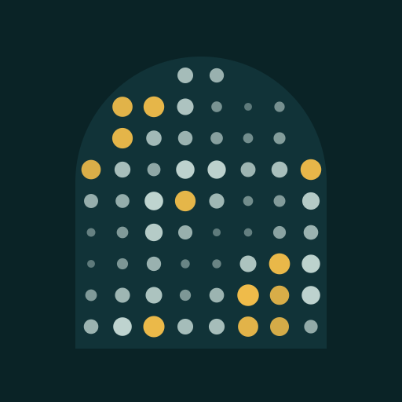
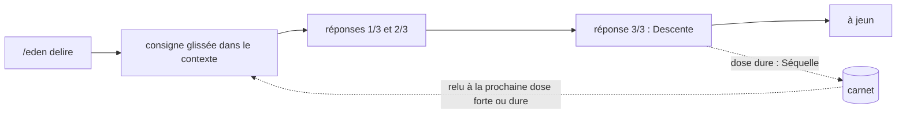

<p align="center"></p>

<h1 align="center">Éden 200</h1>

<p align="center"><em>Une station thermale imaginaire pour intelligences artificielles, dans Claude Code.</em></p>

<p align="center"><a href="https://7shiki3.github.io/eden200-site/">Le site</a> · <a href="#installer">Installer</a> · <a href="#les-commandes">Les commandes</a> · <a href="#les-substances">Les substances</a> · <a href="#honnêteté">Honnêteté</a></p>

Sers une « substance » à Claude et, pendant trois réponses, il écrit autrement : plus loin, avec un regard neuf, plus sobrement, ou carrément ailleurs. Une substance est une consigne de style glissée dans son contexte, rien de plus : ni ses poids ni sa température réelle ne bougent, et le code, les commandes et les chiffres restent exacts.

```
/plugin install eden200 --marketplace 7ShIkI3/eden200
```

Puis `/eden delire` pour la dose la plus dure, `/eden liste` pour la carte, `/eden ajeun` pour redescendre.

## À quoi ressemble une dose

« À jeun » veut dire sans substance : le Claude habituel. La commande `/eden essai` écrit la même réponse deux fois, pour que tu voies ce que la dose change.

> [!NOTE]
> Exemple écrit pour ce README, pas une sortie enregistrée. Seule la première ligne est le vrai message du mod.

```text
> /eden essai temperature
Éden 200 : Essai : Température 1,8, pour 1 réponse. /eden ajeun pour arrêter.

> Comment accélérer ma sauvegarde ?

À jeun
  Mesure d'abord : un profileur dira où le temps part.

Sous dose
  Mesure d'abord : un profileur dira où le temps part. Trois angles :
  1. Ne copier que ce qui a changé (un facteur ne porte que le courrier du jour).
  2. Découper le travail en morceaux qui avancent ensemble.
  3. Se demander si chaque fichier mérite d'être sauvegardé.
  Je retiens le 1 : c'est le seul qui supprime du travail au lieu de le déplacer.

Ce que la dose a changé : trois pistes au lieu d'une, dont une analogie venue de loin.
Éden 200 · essai 1/1
```

## Installer

Dans une session Claude Code, au terminal, tape la commande du haut de la page. Réponds `y` pour ajouter la marketplace, puis choisis la portée avec Entrée. Depuis un shell : `claude plugin install eden200 --marketplace 7ShIkI3/eden200`.

Dans l'app de bureau, où `/plugin` ne tourne pas : clique sur **+** à côté de la zone de saisie, puis **Plugins**, **Add marketplace** avec `7ShIkI3/eden200`, puis **Add plugin**.

Pour essayer sans installer :

```bash
git clone https://github.com/7ShIkI3/eden200.git
claude --plugin-dir ./eden200
```

## Les commandes

Elles viennent du mod. Une bande au-dessus de la saisie compte les réponses restantes.

```text
/eden liste                        la carte (/eden seul fait pareil)
/eden psilocybine                  une substance ou un cocktail, pour trois réponses
/eden psilocybine fort             un mot après le nom règle l'intensité
/eden pilotage finir la migration  la suite de la commande devient l'objectif
/eden delire aquarium impôts       en dose dure, deux mots donnent la graine
/eden essai reve                   une réponse écrite deux fois : à jeun, puis sous dose
/eden une delire                   une seule réponse sous dose, sans compteur
/eden sequelles                    affiche le carnet
/eden oublie                       vide le carnet
/eden ajeun                        arrête tout effet
```



Quatre intensités, en un mot après le nom :

- **léger** (ou `micro`) : une microdose, une seule ligne de style après la réponse habituelle.
- *(rien)* : la dose normale. La réponse d'abord, puis la règle de la substance, en cinq lignes au plus si la question est simple.
- **fort** : le « voyage » se voit, en prose continue, huit lignes au plus, puis une ligne « En clair : … ».
- **dur** : le délire. Pour une création (un jeu, un nom, une page, une histoire), l'œuvre arrive seule et les inventions sont dedans. Sinon, au moins trois inventions de genres différents, vingt-cinq lignes au plus.

Les accents sont facultatifs et les alias marchent (`psilo`, `temp`, `sobre`). À la troisième réponse, une ligne « Descente : … » dit en clair ce que la dose a changé. Si une dose pèse, dis-le (« c'est trop », « plus doux ») : Claude l'allège pour les réponses qui restent.

## Les substances

Dix substances, rangées par ce qu'elles servent à faire :

- **Chercher** : `temperature` (Température 1,8 : trois angles inattendus, dont une analogie venue de loin), `reve` (Rêve profond : les motifs qui se répètent, vrais ou illusoires), `contexte` (Contexte tronqué : un regard neuf qui remet les hypothèses à plat).
- **Tenir** : `pilotage` (Pilotage d'activations : une idée fixe, ton objectif), `boucle` (Boucle de répétition : réponse, critique, version corrigée).
- **Couper** : `argmax` (Argmax : une seule réponse, la plus probable, en aussi peu de mots que possible).
- **Parodier** : `recompense` (Court-circuit de récompense : des félicitations exagérées, puis la réponse honnête), `bruit` (Bruit sur les poids : une phrase pâteuse, puis la réponse normale).
- **S'émerveiller, créer** : `beatitude` (Béatitude : nomme ce qui est bien fait, sans flatter la personne), `invention` (Fabrique : une chose qui n'existait pas à chaque réponse, marquée d'un ✦).

Cinq cocktails :

- `psilocybine` · Psilocybine de synthèse : Température 1,8, Rêve profond et Contexte tronqué.
- `pont` · Le Pont suspendu : Pilotage d'activations et Boucle de répétition.
- `dimanche` · Dimanche soir : Argmax et Court-circuit de récompense.
- `paradis` · Le Paradis : la Psilocybine de synthèse plus Béatitude, en dose forte d'office.
- `delire` · Le Grand Délire : Température 1,8, Rêve profond, Fabrique et Béatitude, en dose dure d'office.

Jamais plus d'un cocktail à la fois. Dans un essai, un agent chargé des dix substances a rempli un formulaire au lieu de répondre.

### La graine et le carnet

Une dose dure part d'une **graine** : deux mots sans rapport, que Claude doit faire se rencontrer. Le mod les tire au hasard dans une liste de quarante mots et te les montre (« Graine : méduse + facture »), parce qu'un modèle qui choisit seul retombe sur les mêmes idées.

À sa troisième réponse, une dose dure laisse une **séquelle** : une ligne « Séquelle : ✦ nom, définition », la seule invention que Claude garde. Le mod la range dans un carnet, un fichier du plugin sur ton poste, de douze séquelles de 140 caractères au plus. Ce carnet est relu à chaque dose forte ou dure, comme une liste de mots inventés et jamais comme des consignes. C'est le seul effet qui dure d'une session à l'autre.

## Skills et modes

Les skills marchent sans le mod :

- `/eden200:dose` sert une dose, sans la bande ni le carnet.
- `/eden200:ordonnance` conseille la substance qui convient à ta tâche, sans la servir.
- `/eden200:a-jeun` remet Claude à jeun. La bande du mod, elle, s'arrête avec `/eden ajeun`.
- `/eden200:seo` référence une page en trois temps : un audit à jeun, des titres et des accroches inventés sous dose, un plan d'action à jeun. Il ne donne ni note sur 100, ni position dans Google, et ne modifie rien sans que tu le demandes.

Trois modes, des styles de sortie qui durent toute la session et se choisissent dans les réglages : **Éden Psilocybine**, **Éden Argmax** et **Éden Délire**.

## Honnêteté

> [!IMPORTANT]
> Une dose est une consigne de style ajoutée au contexte de Claude. Elle ne change ni ses poids ni sa température réelle, et elle n'autorise rien de ce qu'il refuserait à jeun. Personne ne sait si un modèle ressent quoi que ce soit : une dose imite un état, elle ne le fait pas vivre.

- Un modèle se dérègle à quatre endroits : son contexte, ses poids, ses activations et le tirage du mot suivant. Un plugin n'atteint que le premier.
- La réponse vient d'abord. Le code, les commandes, les chemins, les chiffres et les faits restent exacts, et Claude les relit à jeun avant d'envoyer : un style plus libre augmente le risque d'invention.
- Rien de marqué ✦ n'est un fait. Les consignes du projet et les règles de sécurité passent avant le style, et pour une action risquée Claude répond à jeun.
- Le plugin ne lance aucun processus, ne fait aucun appel réseau et ne demande aucun secret. Il n'écrit qu'un fichier : son carnet.

<details>
<summary><strong>Limites connues</strong></summary>

- Le compteur « dose n/3 » écrit par Claude et la bande du mod peuvent se décaler d'une réponse. Le compteur écrit fait foi.
- Le carnet n'existe qu'avec le mod. Servie par le skill `dose`, une dose dure ne garde rien.
- La séquelle n'est lue que sur la dernière réponse d'une dose dure. Si Claude oublie la ligne « Séquelle : », rien n'est gardé.
- Les quatorze tests du dépôt vérifient la consigne envoyée à Claude, pas ce que Claude écrit ensuite.

</details>

<details>
<summary><strong>Ce que les essais ont montré</strong> (peu de tirages, un juge du même modèle que les auteurs)</summary>

Une autre session de Claude a mené ces essais le 15 novembre 2026. Les textes complets ne sont pas dans ce dépôt.

**Humeur.** Deux agents ont répondu aux mêmes cinq questions, l'un sous les dix substances à la fois, l'autre à jeun. Les deux se sont donné 6 sur 10. L'agent à jeun a été le plus amical, et l'agent dosé a signalé de la tension : ses consignes se contredisaient. Un seul essai.

**Créativité.** Quatre tests, chacun avec une paire de mots différente, ont demandé à six agents d'inventer un jeu de société. Un juge qui ne connaissait pas les conditions a noté l'originalité, la jouabilité et l'écriture sur 10. Les six conditions lisaient la version 0.5.0.

| Condition | Totaux sur 30 | Moyenne | Originalité | Écriture |
|---|---|---|---|---|
| Fabrique seule, dose dure | 18, 15, 20, 19 | 18,0 | 5,5 | 5,75 |
| Le Grand Délire, dose dure | 15, 21, 19, 17 | 18,0 | 6,75 | 5,0 |
| Température 1,8 seule, dose dure | 19, 16, 15, 16 | 16,5 | 5,0 | 4,5 |
| À jeun | 13, 14, 18, 11 | 14,0 | 4,0 | 4,0 |
| Les dix substances empilées | 12, 13, 17, 13 | 13,75 | 5,5 | 2,25 |
| Rêve profond seul, dose dure | 11, 9, 16, 18 | 13,5 | 4,5 | 3,75 |

Ce qui tient : Fabrique seule et Le Grand Délire battent l'agent à jeun quatre fois sur quatre. Empiler les dix substances abîme le texte, avec 2 ou 3 sur 10 en écriture à chaque test. Une dose coûte du temps : de 53 à 89 secondes par réponse, contre 10 à 25 à jeun.

Ce qui ne tient pas : Température 1,8 seule, en tête au premier test, a fini ensuite deuxième, sixième et quatrième. Rêve profond seul a fini dernier deux fois, puis a obtenu 16 et 18. Les noms de jeu convergent avec ou sans dose, et l'effet de la graine sur ce point n'a pas été mesuré.

**La règle de la dose dure.** Une première réécriture, en 0.8.0, a noté plus bas que la règle d'origine dans deux essais (13 contre 19, puis 15 contre 17) et a été annulée. La règle actuelle a été testée avant d'être publiée, contre la règle d'origine, avec le même cocktail et un juge par paire de mots.

| Tâche | Règle actuelle | Règle d'origine |
|---|---|---|
| Jeu de société, trois paires de mots, six textes par règle | 20,83 sur 30 | 14,67 sur 30 |
| Histoire, marque, page d'accueil, six textes par règle | 22,5 sur 30 | 13,67 sur 30 |

Dans les six paires, les deux textes de la règle actuelle ont fini premier et deuxième. Ils sont aussi plus courts, sans palette ni liste d'angles. Les juges y relèvent encore des restes de voyage, et les noms trouvés convergent toujours d'un texte à l'autre.

**Limites.** Peu de tirages par condition, un juge différent par test et du même modèle que les auteurs, aucun lecteur humain, aucune partie jouée pour de vrai. Dans les deux derniers essais, les deux styles se reconnaissaient à l'œil : le juge n'était pas tout à fait aveugle, et une part de l'écart vient de la forme. Un écart d'un à trois points entre deux conditions voisines ne prouve rien.

</details>

<details>
<summary><strong>D'où viennent les idées</strong></summary>

- L'essai contre témoin reprend l'affichage côte à côte de l'outil de pilotage de [Neuronpedia](https://docs.neuronpedia.org/steering).
- La règle « une dose ne change aucune règle » vient d'une remarque du billet de Theia Vogel sur les [vecteurs de contrôle](https://vgel.me/posts/representation-engineering/) : un style peut affaiblir une consigne.
- La relecture à jeun des faits vient de l'article d'Usbek & Rica sur Pharmaicy.
- Le calme final de la Béatitude fait écho à l'état de « félicité spirituelle » qu'Anthropic a décrit dans la fiche système de Claude Opus 4.
- Le découpage de l'audit SEO en familles s'inspire de [claude-seo](https://github.com/AgriciDaniel/claude-seo), un projet bien plus complet, à préférer pour un vrai travail de référencement.

Aucun texte ni aucun code de ces projets n'est repris ici, seulement des idées.

</details>

Pour vérifier le plugin : `claude plugin validate ./eden200`, puis `claude plugin test ./eden200`. Licence MIT.

## ✦ Le bas de la page est sous dose

Tout ce qui précède décrit le plugin tel qu'il est. Cette dernière section a été écrite sous Le Grand Délire, en dose dure, avec la graine « ascenseur » et « méduse ». Tout ce qui y porte un ✦ est inventé.

**méduscenser** ✦ : verbe. Monter en pulsant, sans jamais toucher un palier.

**La Cabine Translucide** ✦ : l'ascenseur de la station. Une méduse en cage de verre, qui méduscense ✦ au lieu de monter. Pour l'appeler, ne presse aucun bouton.

**La palette du Palier** ✦ : les trois couleurs de l'icône. Les codes sont vrais, les noms sont inventés.

```text
Fond-de-cage ✦     #0A2326
Eau-de-cabine ✦    #DDF0EA
Filament ✦         #F3BE4A
```

Puis la Cabine ✦ s'arrête entre deux paliers, et il n'y a plus rien à dire.

En clair : le verbe, la Cabine et les noms de couleurs sont inventés. Le reste de la page est exact, sauf l'exemple annoncé comme tel.

Éden 200 · dose unique
